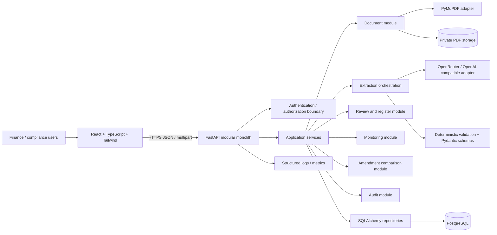

# Covenant Intelligence — System Architecture

## Purpose and scope

Covenant Intelligence turns corporate credit agreement PDFs into a traceable draft register of financial covenants, reporting obligations, and negative covenants, then supports human approval and quarterly monitoring. It is decision support for finance and compliance teams, not legal advice. It does not calculate financial ratios, connect to ERP systems, or approve extracted obligations automatically. Use only public or synthetic agreements and data.

Every extracted item must be tied to exact source evidence (document version, page, and text span or quote). The original AI result remains immutable and distinct from a human-approved register record. Missing or ambiguous evidence, uncertain interpretation, unresolved definitions, and failed validation route to human review.

## System shape

Use a modular monolith: one React/TypeScript web client and one FastAPI application backed by PostgreSQL. Modules are separated by responsibility inside the backend; they are not independently deployed services. PDF parsing and LLM calls are adapters called by application services. Store source PDFs in a private local volume for development and behind a storage interface so deployments can use a private object store. PostgreSQL holds metadata, extracted text, evidence, extraction runs, review decisions, approved obligations, monitoring periods, and audit events.



## Current implementation safety behavior

Amendment comparison records extraction coverage (run status, total/processed/unprocessed/screened chunks, document/extracted pages, and pages containing text). A missing match is `unresolved` unless every page and chunk is covered, all text is present, and no chunks were screened out. Complete coverage only permits a removal *proposal*; it does not establish that the agreement removed the covenant. The UI provides original approved wording/evidence, the compared version, complete extracted amendment text, and a protected link to the original PDF. A reviewer/admin must attest that the complete PDF was reviewed and enter an explanation before accepting a removal. The original remains active until acceptance, and the decision is audited.

Monitoring permissions are checked in the API: contributors can initialize periods and record progress through `submitted`; reviewer/admin roles may also record `reviewed`, `not_assessed`, and `not_applicable`; read-only users cannot mutate. The frontend control follows the same identity header and role labels. Seeded identities and `X-Dev-User` are development-only, not production identity management.

The migration test uses an isolated temporary database and closes both connections and engines explicitly. It does not reset or migrate a user's existing database.

Frontend CORS is explicit and configurable. `FRONTEND_PORT` sets Vite's strict port and the default `localhost`/`127.0.0.1` API origins; `CORS_ALLOWED_ORIGINS` can replace those with an explicit comma-separated allowlist. Wildcard origins are rejected. Keep the frontend port and API allowlist aligned.

For the MVP, seed one development workspace and development reviewer identities. The client selects a seeded identity through a development-only mechanism; every request is resolved to that identity and workspace, and authorization checks scope all reads and writes to the workspace and role at the API/use-case boundary. This is development-only authentication, not production identity management: it must not be represented as secure login or used for real agreements. No secrets belong in source control. Production deployment requires a real identity provider and reviewed authorization/session design.

## Backend modules and folder structure

Proposed structure (names are guidance, not an implementation commitment):

```text
backend/
  app/
    main.py                 # FastAPI composition and router registration
    api/v1/                 # HTTP schemas, dependencies, routers
    core/                   # settings, auth, errors, logging
    db/                     # engine, session, base, migrations integration
    modules/
      agreements/           # agreement and version use cases / models
      documents/            # upload, page extraction, storage abstraction
      extraction/            # prompts, provider adapter, schemas, validation
      obligations/           # evidence-backed drafts and approved records
      review/                # human decisions and corrections
      monitoring/            # reporting periods, status, reminders
      amendments/            # version linking and comparison proposals
      audit/                 # append-only business event recording
    shared/                  # IDs, pagination, clock, common value types
  alembic/
  tests/
```

Routers translate HTTP to use-case calls; use cases own transaction boundaries and authorization checks; repositories isolate SQLAlchemy persistence; domain rules do not depend on FastAPI, PyMuPDF, or a model provider. Pydantic request/response schemas are distinct from SQLAlchemy models and internal domain types. Alembic owns schema changes. Keep prompt/provider code behind an extraction interface and keep document parsing behind a parser interface.

## Frontend structure

```text
frontend/
  src/
    app/                    # routes, providers, shared layout
    features/
      agreements/           # agreement list, versions, upload
      extraction/           # run status and draft results
      review/                # evidence viewer, edit, approve/reject
      register/              # approved obligations and filters
      monitoring/            # quarter tracker and status updates
      amendments/            # proposed changes and side-by-side evidence
      audit/                 # event history
    components/              # accessible shared UI components
    api/                     # typed API client and error handling
    types/                   # shared frontend response types
    styles/
```

The user interface should make draft versus approved state unmistakable, show source document/version and page evidence alongside every obligation, and expose unresolved definitions and validation warnings. No UI action should imply that a machine-generated draft is legally definitive. Monitoring uses the same stored statuses as the database: `awaiting_setup`, `upcoming`, `due`, `awaiting_evidence`, `submitted`, `reviewed`, `not_assessed`, `not_applicable`. `overdue` is derived when `due_date` is before the current date and status is `awaiting_setup`, `upcoming`, `due`, or `awaiting_evidence`; it is not a user-set status. Use accessible keyboard navigation, visible status labels, and clear empty/error/loading states.

The current implementation's frontend keeps `monitoring/`, `amendments/`, and `audit/` under `src/features/`. Its current single-screen ingestion/extraction UI is in `src/App.tsx`; the feature directory layout above remains the target modular organization.

## Core data flow

1. An authorized user creates an agreement and uploads a PDF as a new immutable version. Compute a content hash, record filename, uploader, timestamp, and source classification (public/synthetic).
2. Validate PDF type, size, encryption/readability, and page count. Persist the original bytes privately; never alter the source file.
3. Extract text page by page with PyMuPDF. Store page number, extracted text, extraction method, and warnings such as empty or low-text pages. Do not silently claim OCR support; scanned-page OCR is a separately scoped adapter/decision.
4. A user explicitly starts extraction for a processed version. Build bounded page/chunk inputs with stable page references; call the configured OpenRouter model through the OpenAI-compatible adapter. Persist provider/model, prompt/schema versions, run status, timestamps, sanitized provider usage metadata, and validation findings. Do not persist raw provider responses or log prompt/document contents.
5. Parse response into a strict Pydantic schema. Deterministic validators verify evidence page references, quote presence against extracted page text, required fields, dates/threshold types, and supported obligation categories. These checks establish traceability, not legal correctness. Uncertainty, invalid output, or absent evidence is flagged for review; nothing is approved automatically.
6. Save immutable extraction candidates and their evidence. Reviewers compare candidate text with the PDF, definitions, and cross-references; they may correct, reject, or approve. Approval creates or updates a separate approved obligation record and records actor, time, decision, and source candidate. Every material change is audited.
7. Approved obligations with a monitoring cadence generate or are assigned quarterly tracker entries. Users record status and supporting notes/evidence; the application does not compute financial metrics or infer compliance from company financials.
8. An amendment is uploaded as another agreement version and processed independently. Comparison proposes additions, changes, removals, or uncertain mappings between approved records and new draft candidates. A human confirms all effects before approved records change.

## API specification

Base path is `/api/v1`. PDF upload uses multipart form data; other request bodies are JSON. IDs are UUIDs and timestamps are ISO 8601. Collection endpoints return the scoped result set unless an explicit `limit` is documented; cursor pagination is deferred. FastAPI errors use `{ "detail": "..." }` or a structured `detail` object. All endpoints resolve `X-Dev-User` against one seeded development workspace and enforce workspace scoping. This identity mechanism is development-only, not production identity management.

### Agreements and document versions

- `GET /agreements` — list workspace agreements.
- `POST /agreements` — contributor/admin creates one. Request `{ "name": "Northstar Revolver", "counterparty": "Northstar Ltd" }`; response `201` `{ "id": "uuid", "name": "Northstar Revolver", "counterparty": "Northstar Ltd", "created_at": "..." }`.
- `GET /agreements/{agreement_id}` — scoped agreement metadata.
- `GET /agreements/{agreement_id}/versions` — immutable versions.
- `GET /agreements/{agreement_id}/versions/{version_id}` — scoped version metadata.

### PDF upload and processing

- `POST /agreements/{agreement_id}/versions` — multipart fields `file`, `version_label`, and `source_kind` (`public` or `synthetic`). Response `201` contains version ID, SHA-256, byte/page count, file name, and `status: uploaded`. Original bytes are stored under the configured private local storage directory.
- `POST /versions/{version_id}/process` — extract page text with PyMuPDF. Response `200` `{ "version_id": "uuid", "status": "processed", "page_count": 42, "warnings": [] }`.
- `GET /versions/{version_id}/pages` — page numbers, text availability, page hash, and warnings.
- `GET /versions/{version_id}/pages/{page_number}` — full extracted page text and hash.
- `GET /versions/{version_id}/pdf` — workspace-scoped original PDF bytes for human inspection.

### Extraction runs and candidates

- `POST /versions/{version_id}/extraction-runs` — start a run after the version is processed. Request categories may include `financial_covenant`, `reporting_obligation`, `affirmative_covenant`, and `negative_covenant`; response `202` contains run ID, schema version, and queued status.
- `GET /extraction-runs/{run_id}` — state, provider/model, prompt/schema versions, chunk counts, findings, and sanitized errors.
- `GET /extraction-runs/{run_id}/candidates` and `GET /candidates/{candidate_id}` — immutable candidates with complete `canonical_payload`, validation findings, and relational evidence rows.

Example candidate fragment: `{ "id":"uuid", "status":"awaiting_review", "canonical_payload": { "obligation_category":"reporting_obligation", "obligation_description":"Deliver quarterly certificate", "source_wording":"[source wording]", "threshold_value":null, "comparison_operator":null, "threshold_unit":null, "measurement_basis":null, "testing_frequency":"quarterly", "testing_period":null, "reporting_deadline":null, "deadline_calculation_rule":null, "conditions":null, "exceptions":null, "referenced_definitions":null, "cross_references":null, "supporting_evidence":[{"quote":"[verbatim quote]", "source_page":18, "source_section":"Section 6.2"}], "uncertainty_reasons":[] }, "evidence":[{"page_number":18,"quote":"[verbatim quote]"}] }`. Unavailable schema fields are `null`; every obligation requires source evidence. A quote match is provenance validation only, not proof of interpretation.

### Human review and approved obligation register

- `GET /review/candidates` — candidates without terminal decision (workspace-scoped).
- `GET /review/candidates/{candidate_id}` — candidate, version metadata, evidence and cited page text.
- `POST /candidates/{candidate_id}/review-decisions` — admin/reviewer records one of `approved`, `corrected`, `rejected`, or `needs_information`. Request example: `{ "action":"corrected", "comment":"Verified the revised wording against page 4.", "corrected_obligation": { ...complete canonical object... } }`. `corrected_obligation` is a single full object validated against `EXTRACTION_SCHEMA.md` `$defs.obligation`, not a partial patch or top-level batch envelope with an `obligations` array. Every field and every evidence page, quote, definition and cross-reference is validated again before approval. Response `201` includes `decision_id`, `candidate_id`, `decision`, `obligation_id`, and `revision_id`. Invalid evidence/fields return `422`; an already-final candidate returns `409`. The immutable original candidate is not edited.
- `GET /obligations?agreement_id=...&category=...&search=...&sort=deadline` — approved register.
- `GET /obligations/{obligation_id}` — current revision and evidence.
- `GET /obligations/{obligation_id}/revisions` — revision and source history.

The approved canonical payload and relational Evidence rows are persisted in the same database transaction. The reviewer decision, revision and audit event share the same transaction.

### Monitoring periods

- `POST /obligations/{obligation_id}/monitoring-periods` — create a period. Request `{ "period_label":"FY2026 Q1", "period_start":"2026-01-01", "period_end":"2026-03-31", "fiscal_year_end":null, "due_date":null }`. An explicit due date takes priority; otherwise only supported, clear calendar-day period-end rules are calculated. Response includes `due_date`, `deadline_rule`, `status`, `deadline_resolution`, and derived `is_overdue`.
- `GET /monitoring-periods?agreement_id=...&status=...&period_label=...&overdue=true` — list/filter periods. The special filter `status=overdue` is derived and is never stored.
- `GET /monitoring-periods/{period_id}` — scoped period and update history.
- `POST /monitoring-periods/{period_id}/updates` — append status/evidence note. Request `{ "status":"submitted", "note":"Certificate received", "supporting_reference":"internal://certificate-q1", "evidence_received_at":"2026-04-20" }`. Allowed stored statuses are `awaiting_setup`, `upcoming`, `due`, `awaiting_evidence`, `submitted`, `reviewed`, `not_assessed`, `not_applicable`. Response returns current status, update history and derived overdue flag.

### Amendment comparison

- `POST /agreements/{agreement_id}/amendment-comparisons` — compare a base version with an extracted amendment. Request `{ "base_version_id":"uuid", "amendment_version_id":"uuid", "extraction_run_id":"uuid" }`. The run must be completed for the amendment version and both versions must belong to the agreement. Candidates with terminal review decisions are excluded so a finalized candidate is not applied twice. Response `201` includes comparison status and proposal items.
- `GET /agreements/{agreement_id}/amendment-comparisons` — list comparison history and items.
- `GET /comparison-items/{item_id}/removal-review` — for unresolved/removal items, return the compared version metadata, complete page text, and coverage record so the reviewer can inspect all extracted pages; the original PDF is retrieved from the workspace-scoped PDF endpoint above.
- `POST /comparison-items/{item_id}/decisions` — admin/reviewer accepts, rejects, or defers a proposal. A removal acceptance requires `{ "decision":"accepted", "comment":"Reviewed all pages of the amendment and confirmed the covenant is removed.", "full_document_review_confirmed":true }`; without both the comment and explicit confirmation the API returns `422`. The decision persists the attestation and reviewer explanation. The prior obligation remains active until an accepted decision commits. Acceptance of an amended candidate revalidates its complete canonical payload and creates a new evidence-backed revision. Reject/defer leaves the register unchanged.

Matching uses deterministic category/name matching and similarity; proposals are not legal conclusions. Every item requires human review.

### Audit history

- `GET /audit-events?action=...&entity_type=...&limit=100` — read-only, workspace-scoped audit events; `limit` is 1–500. Response is an array with event ID, actor, action, entity, timestamp, request ID, and allowlisted summary. Audit rows are append-only at the application layer. No agreement-text bodies or credentials are included in summaries.

Common responses: `401` for missing/unknown development identity; `403` for disallowed role; `404` for absent or out-of-workspace record; `409` for conflicting final decision/duplicate period/invalid state; `413` for upload size; `422` for schema, evidence, or request validation. Out-of-workspace resources are not disclosed.

## Cross-cutting controls

- **Provenance:** evidence points to an immutable document version and page. Keep quote text and optionally character offsets; validate quote against the stored page text. Never generate a citation from model output without checking it.
- **Separation of states:** extraction candidates are immutable; approved records are human-controlled. Corrections create a new decision/revision rather than rewriting the original model response.
- **Idempotency:** uploads record content hashes and create explicit immutable versions; the same file can be uploaded again as a separate version. Each extraction invocation creates an explicit run; request idempotency keys are not currently implemented.
- **Authorization:** enforce tenant/workspace and role access in use cases, not only in the UI. Suggested roles: admin, reviewer, contributor, read-only. Scope sharing is an explicit product/security decision.
- **Audit:** append business events for upload, extraction, review, approval, correction, monitoring updates, and amendment decisions. Do not store credentials or unnecessary raw personal data in events.
- **Reliability:** extraction is a potentially long operation. The initial deployment may run it synchronously for small documents; define a job interface/status model so it can move to an in-process background runner without changing domain rules. Avoid a separate service/queue until measured need exists.
- **Data protection:** private storage, TLS in deployment, least-privilege credentials, bounded upload sizes, retention/deletion policy, and provider data handling review are required before real agreements are used.

## Technical risks and alternatives

| Risk | Mitigation / alternative |
|---|---|
| LLM omits, invents, or misreads a clause | Require quote/page evidence; validate quotes deterministically; show source in review; treat all outputs as drafts. Consider multiple targeted passes or retrieval if recall testing supports it. |
| Definitions and cross-references span distant pages | Include a definition-resolution stage that returns cited definition candidates and unresolved references; never substitute an uncited interpretation. Human review resolves ambiguity. |
| Scanned PDFs produce empty text | Detect low-text pages and mark extraction incomplete. OCR (for example, a dedicated OCR adapter) is an optional future capability requiring its own provenance and quality checks. |
| Large agreements exceed context or cost budgets | Chunk by page/section with overlap and page map; extract per obligation category; record model/token metadata; benchmark before selecting limits. |
| Provider changes or outages | OpenAI-compatible provider interface, configurable model, bounded retries, explicit failed state, and stored provider/model metadata. Avoid assuming identical structured-output behavior across providers. |
| Amendment comparison falsely maps clauses | Present proposed mappings with both versions' evidence and confidence/reasons; require reviewer confirmation. |
| Unclear security/tenant requirements | Decide deployment, identity, tenancy, storage, and retention before production data; keep adapters and authorization boundaries explicit. |
| Quarterly deadlines vary by agreement/calendar | Preserve source language and extracted date rule; human confirms the interpretation and monitoring period. Do not silently calculate calendar rules from vague text. |

## Non-goals for the first implementation

No ratio calculations, financial statement ingestion, ERP integration, autonomous legal interpretation, automatic approval, autonomous amendment adoption, or production-grade OCR unless explicitly added to scope.

## Step 3/4 operational limits

Extraction uses page-mapped chunks and does not discard chunks using keyword screening, because covenant language varies and a lexical filter cannot establish irrelevance. The configured maximum chunk count still bounds work; if that limit is reached, `unprocessed_chunk_count` and an incomplete-coverage warning are recorded. `screened_out_chunk_count` remains for historical/schema compatibility and is zero for new runs. No extractable page text is a failed run, not a finding that the agreement contains no obligations. An empty result after processing text means only that the provider returned no obligations for the processed text; it is not proof of absence. Scanned-page OCR is not enabled. Deadline calculation handles only clearly worded calendar-day rules with supported period-end anchors; business-day, holiday, and ambiguous rules need human date configuration. Amendment pairing is deterministic category/name similarity and can miss matches or propose false matches. Live OpenRouter behavior remains subject to the configured provider/account and is not implied by mock tests.
