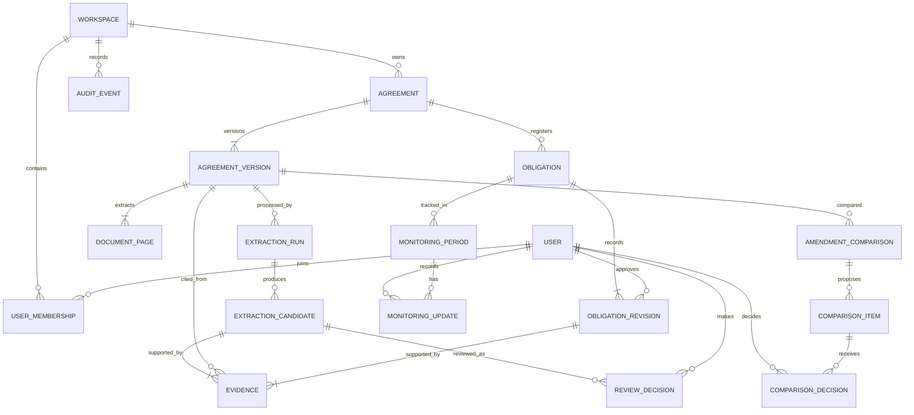

# Covenant Intelligence — Data Model

## Modeling principles

The model preserves immutable source versions and extraction outputs, verified evidence, human decisions, and approved obligations as distinct records. Use UUID primary keys, UTC timestamps, database foreign keys, and SQLAlchemy/Alembic migrations. Store monetary/ratio thresholds as structured decimal values plus the original source wording; never derive actual borrower ratios. Prefer explicit enums with migration-safe evolution. Soft deletion may hide user-facing records, but must not erase audit or source provenance absent a defined retention workflow.

`ExtractionCandidate.canonical_payload` and `ObligationRevision.canonical_payload` are immutable JSON documents preserving every field in `docs/EXTRACTION_SCHEMA.md` `$defs.obligation`. Normalized columns can support filtering without replacing these payloads. Candidate payloads preserve the original AI output; approved revision payloads preserve the complete human-approved or corrected object. Supporting evidence also has relational `Evidence` rows. Payload and evidence rows are written together in one transaction and carry agreement-version/page provenance.

## Entity relationship diagram

Monitoring statuses are `awaiting_setup`, `upcoming`, `due`, `awaiting_evidence`, `submitted`, `reviewed`, `not_assessed`, and `not_applicable`. `overdue` is derived from due date and nonterminal status rather than stored as a separate assessment.

`AmendmentComparison.extraction_coverage_complete` and `coverage_details` persist the run/chunk/page coverage check. `ComparisonItem.change_type=unresolved` represents an unmatched prior obligation when coverage is incomplete; `removed` is reserved for no match after complete coverage and remains a proposal. Both retain the prior revision link. `ComparisonDecision.full_document_review_confirmed` records the explicit PDF-review attestation; `comment` stores the reviewer explanation. The existing obligation is not superseded until an accepted decision commits. These columns are introduced by Alembic revision `0004_amendment_review_safety`.

An `EVIDENCE` record may point to either an extraction candidate or an approved obligation revision (use two nullable foreign keys plus a check constraint requiring exactly one, or separate candidate/approved evidence tables if that is clearer for the chosen ORM). It always points to an agreement version and page. The diagram's repeated relationship is conceptual; enforce unambiguous ownership in the implementation.

## Entities and key fields

### Workspace and users

- **Workspace**: `id`, `name`, `created_at`.
- **User**: `id`, stable identity-provider subject (or development identity), `display_name`, `email` if needed, `created_at`, `disabled_at`.
- **UserMembership**: `workspace_id`, `user_id`, `role` (`admin`, `reviewer`, `contributor`, `read_only`), `created_at`, `created_by`. Unique on workspace/user.

For the MVP, seed exactly one development workspace and development reviewer identities as `User`/`UserMembership` records. A development-only identity selector or header resolves to a seeded user; all operations must enforce workspace membership and role in application services. This is not production identity management and must not be described or used as secure production authentication. A later deployment requires a real identity provider. Workspace scoping enables access checks even though the take-home runs as a single workspace.

### Agreement and immutable version

- **Agreement**: `id`, `workspace_id`, `name`, `counterparty` (optional), `agreement_type` (optional), `created_at`, `created_by`, `archived_at`.
- **AgreementVersion**: `id`, `agreement_id`, `version_label`, `source_kind` (`public`, `synthetic`), `original_filename`, `sha256`, `storage_key`, `mime_type`, `size_bytes`, `page_count`, `uploaded_at`, `uploaded_by`, `supersedes_version_id` (nullable self-FK), `status`.
- Unique content hash is useful for duplicate warnings, but should not prohibit intentionally uploading the same source as a separate agreement/version. Never mutate bytes or version metadata that change source identity; add a new version instead.

### Page text and extraction runs

- **DocumentPage**: `id`, `agreement_version_id`, `page_number` (1-based), `text`, `extraction_method` (`pymupdf_text`, future OCR), `warnings` JSON, `text_sha256`, `created_at`. Unique on version/page.
- **ExtractionRun**: `id`, `agreement_version_id`, `status` (`queued`, `running`, `succeeded`, `partial`, `failed`, `cancelled`), `provider`, `model`, `prompt_version`, `schema_version`, `started_at`, `completed_at`, `requested_by`, `error_code`, sanitized `error_summary`, `input_manifest` JSON. Store raw provider response only when justified, access-restricted, and under a defined retention policy.

### Extraction candidate and evidence

- **ExtractionCandidate**: `id`, `extraction_run_id`, normalized/queryable projections such as `kind`, `name`, `threshold`, and `validation_status`, plus immutable `canonical_payload` JSONB and `created_at`. `canonical_payload` is the complete immutable single-obligation object conforming to `docs/EXTRACTION_SCHEMA.md` `$defs.obligation` for the run's recorded schema version. It preserves every canonical field: obligation category and description, source wording, threshold value/operator/unit/measurement basis, testing frequency/period, reporting deadline/calculation rule, conditions/exceptions, referenced definitions, cross-references, supporting evidence, and uncertainty reasons. The original AI candidate payload is never overwritten by review corrections; corrections are recorded in review decisions and the approved obligation revision.
- **Evidence**: `id`, `agreement_version_id`, `page_number`, `quote`, `start_offset`/`end_offset` nullable, `evidence_role` (operative clause, definition, cross-reference, etc.), `candidate_id` nullable, `obligation_revision_id` nullable, `created_at`. Validate that the page exists and quote matches its extracted text after normalization. Offsets are aids and must be interpreted against the stored page text hash.

Threshold/deadline representation must preserve source wording. Normalized fields should include explicit units/operators/periods only when unambiguous (e.g. `{operator: "<=", value: "3.50", unit: "x", basis: "Total Leverage Ratio"}`); otherwise leave normalized values null and explain the uncertainty. `canonical_payload` is the authoritative immutable full-fidelity record for each candidate/revision; normalized columns are derived projections for filtering and querying and must not replace or silently mutate the canonical object. It is not a financial ratio calculator.

### Review, approved register, and revisions

- **ReviewDecision**: `id`, `candidate_id`, `reviewer_id`, `decision` (`approved`, `corrected`, `rejected`, `needs_information`), `comment`, `created_at`, `supersedes_decision_id` nullable. Decisions are append-only; correction is represented by the resulting approved revision and a link to the candidate/decision.
- **Obligation**: stable register identity: `id`, `agreement_id`, `current_revision_id` nullable until first approval, `lifecycle_status` (`active`, `superseded`, `terminated`, `closed`), `created_at`, `created_by`.
- **ObligationRevision**: `id`, `obligation_id`, `revision_number`, normalized/queryable projections such as `kind`, `name`, and `threshold`, `canonical_payload` JSONB, `status` (`approved`, `superseded`), `approved_by`, `approved_at`, `origin_candidate_id`, `review_decision_id`, `created_at`. `canonical_payload` preserves the complete human-approved single-obligation object conforming to `docs/EXTRACTION_SCHEMA.md` `$defs.obligation`, including category and description, source wording, threshold value/operator/unit/measurement basis, testing frequency/period, reporting deadline/calculation rule, conditions/exceptions, referenced definitions, cross-references, supporting evidence, and uncertainty reasons. It is immutable after approval. Unique on obligation/revision number. Never overwrite an approved revision; create a new one after a human-confirmed correction or amendment.

### Quarterly monitoring

- **MonitoringPeriod**: `id`, `obligation_id`, `obligation_revision_id`, `period_label`, `period_start`, `period_end`, `due_date` nullable, `status` (`awaiting_setup`, `upcoming`, `due`, `awaiting_evidence`, `submitted`, `reviewed`, `not_assessed`, `not_applicable`), `deadline_rule`, `fiscal_year_end`, `created_at`, `created_by`. Unique constraint should prevent duplicate periods for a given obligation/revision and period label. `overdue` is a derived display/filter state, never a stored status or manual compliance decision: derive it when `due_date` is before the current date and stored status is `awaiting_setup`, `upcoming`, `due`, or `awaiting_evidence`. A period with status `submitted` remains submitted while awaiting review and is not labeled overdue; `reviewed`, `not_assessed`, and `not_applicable` are also excluded.
- **MonitoringUpdate**: `id`, `monitoring_period_id`, `status`, `note`, `supporting_reference` (optional text/file reference), `evidence_received_at`, `recorded_by`, `recorded_at`. Updates are append-only; current status can be derived from the latest update or materialized with a transactionally maintained pointer.

The tracker records user-reported status and evidence. It must not calculate leverage, coverage, liquidity, or other actual financial ratios. Deadlines are populated only from an approved, sufficiently clear rule; otherwise show as unresolved for a reviewer. The shared status vocabulary is `awaiting_setup`, `upcoming`, `due`, `awaiting_evidence`, `submitted`, `reviewed`, `not_assessed`, and `not_applicable`; `overdue` is derived when `due_date` is before the current date and status is `awaiting_setup`, `upcoming`, `due`, or `awaiting_evidence`. It is not independently assigned by a user. API/UI may expose a derived `is_overdue` boolean or display label while preserving the stored status.

### Amendment comparison and audit

- **AmendmentComparison**: `id`, `agreement_id`, `base_version_id`, `amendment_version_id`, `status` (`running`, `ready_for_review`, `completed`, `failed`), `created_by`, `created_at`, `completed_at`, `algorithm_version`.
- **ComparisonItem**: `id`, `comparison_id`, `change_type` (`added`, `changed`, `removed`, `possible_match`, `unresolved`), `prior_obligation_revision_id` nullable, `candidate_id` nullable, `proposed_changes` JSON, `rationale`, `confidence` nullable, `status` (`pending`, `accepted`, `rejected`, `deferred`). A proposal is not effective until human decision creates/updates approved records.
- **ComparisonDecision**: `id`, `comparison_item_id`, `reviewer_id`, `decision`, `comment`, `created_at`.
- **AuditEvent**: `id`, `workspace_id`, `actor_user_id` nullable for system events, `action`, `entity_type`, `entity_id`, `occurred_at`, `request_id`, `summary` JSON with allowlisted fields. Append-only; avoid duplicating full contracts or secrets into event payloads.

## Integrity constraints and indexes

- Foreign keys cascade only where deletion cannot break audit/provenance; otherwise restrict deletion or use explicit retention procedures.
- Check exactly one evidence owner (candidate or obligation revision), page number >= 1, positive byte/page counts, and supported status values.
- Unique `(agreement_version_id, page_number)`, `(obligation_id, revision_number)`, and monitoring-period identity.
- Index workspace ownership, agreement/version chronology, extraction status, candidate review status, obligation lifecycle, monitoring due date/status, and audit entity/time.
- All API reads and writes filter by authorized workspace; IDs alone are not authorization.

### Implemented payload and evidence invariants

`ExtractionCandidate.canonical_payload` and `ObligationRevision.canonical_payload` each retain the complete object validated against `docs/EXTRACTION_SCHEMA.md` `$defs.obligation`, including all nested definition, cross-reference, and evidence fields. The original extraction candidate is immutable. The approved revision stores the complete human-approved replacement, not a projection or partial patch. Queryable values may be normalized into relational columns only as derived projections; the canonical JSON payload remains authoritative. Supporting evidence is duplicated as relational `Evidence` rows linked to the candidate or revision and immutable agreement version/page. Payload and evidence rows are written together in the same database transaction so a commit cannot leave one representation without the other. Review decision, approved revision, and audit event also commit or roll back together.

The eight monitoring statuses are the only stored/API/frontend statuses. `overdue` is computed from the due date and open statuses at read time. Each `MonitoringUpdate` is an append-only status/evidence note history row; `MonitoringPeriod.status` is the current materialized status. Application updates append history and update current status atomically.
